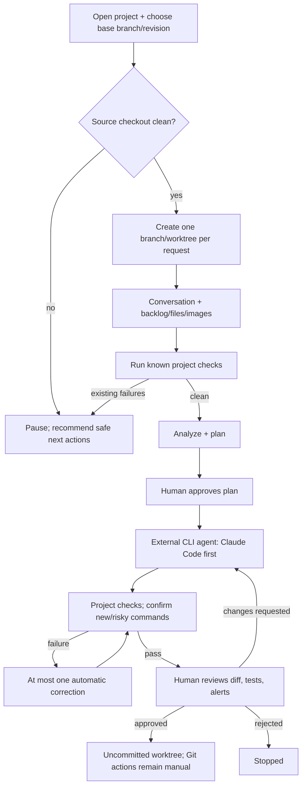

# MAT — Arquitetura

> Documento de arquitetura desejada e estado implementado. O roadmap define a
> ordem de entrega; componentes planejados não devem ser tratados como prontos.

## 1. O que o MAT é

O MAT é um workflow controlado com chamadas de agentes delimitadas, tentativas
persistidas e checkpoints humanos. Não é um sistema de agentes livres. A
aprovação humana final é obrigatória; o MAT prepara um worktree sem publicar PR
ou criar commit.

## 2. Diagrama do Pipeline



O diagrama representa o alvo, não a capacidade atual. A execução atual da CLI usa
stubs. O suporte a diferentes linguagens será delegado ao agente CLI; comandos
de validação serão descobertos por projeto. Testers Bypass/Breaker, paralelismo
e Consolidador ficam para depois da fatia sequencial.

A execução do agente no WSL ainda não tem fronteira de segurança comprovada.
Um protótipo descartável deve verificar acesso fora do worktree, subprocessos,
rede e exposição de credenciais antes de habilitar o modo real.

## 3. Stack

| Camada | Tecnologia |
|---|---|
| **Runtime atual** | Python 3.12+ |
| **Banco** | SQLite WAL via `aiosqlite`; reader/writer separados |
| **Agente planejado** | Adaptadores para coding-agent CLIs; Claude Code primeiro |
| **Runner atual** | Docker CLI com rede desabilitada, rootfs read-only e limites de recursos |
| **UI** | CLI atual; Textual é a primeira interface interativa planejada, ainda não integrada |
| **Git** | Gerenciador de worktree existe, mas ainda não está integrado à CLI |

## 4. Estrutura do Projeto

Veja árvore em `src/mat/` no repositório. Referência:

```
src/mat/
├── cli.py              # entry point (mat run, mat report; resume ainda não existe)
├── settings.py         # carrega mat.yaml + agents.yaml (Pydantic)
├── db/                 # SQLite: schema, connection, repos/
├── engine/             # pipeline, state_machine, orchestrator, budget
├── agents/             # base, loop, llm, analyst, programmer, reviewer, testers/, verifier
├── tools/              # handlers para text_editor e bash (validação de path)
├── sandbox/            # docker_runner, worktree
├── gate/               # deterministic (pytest/ruff/coverage), baseline
├── models/             # Pydantic: Plan, Implementation, TestResult, Verdict
├── evidence.py         # hash content-addressed + ledger
├── decision.py         # choose/score com structured output (só Analista)
├── memory/             # embedder, pr_store, indexer (Fase 2)
└── tui/                # Textual app, screens, widgets
```

## 5. Modelo de Dados

O schema completo está em [`src/mat/db/schema.py`](../src/mat/db/schema.py).

Tabelas principais:
- **runs**: status do fluxo, `execution_mode` (`unknown`, `simulation`, `real`), fase e contadores
- **plans**: plano gerado pelo Analista, vinculado à run
- **baselines**: pytest/ruff/coverage medidos ANTES de qualquer mudança
- **attempts**: tentativa imutável (plan_index × attempt_index), tokens, timeout
- **tasks**: unidade de trabalho por agente
- **task_deps**: dependências normalizadas (sem JSON)
- **dispatches**: execução de uma task numa attempt
- **evidence**: ledger content-addressed com PK composta (evidence_id, run_id)
- **checkpoints**: snapshot de estado para pausa/retomada

Runs antigas recebem `execution_mode=unknown` na migração. Execuções com stubs
devem ser registradas como `simulation`; `passed` em uma simulação não significa
que o código do repositório foi validado. O modo `real` só deve ser usado quando
agentes, worktree, runner e gates reais estiverem conectados.

## 6. Controle de Tentativas (sem ciclos no DAG)

Não existem arestas de volta. Cada reprovação cria uma **Attempt nova e imutável**.

```
Plano 1 (Analista)
  ├── Attempt 1 → Programador → Corretor → Gate → Tester → Verificador → ❌
  ├── Attempt 2 → Programador → ... → ❌
  └── Attempt 3 → ... → ❌ → ESCALA para novo plano

Plano 2 (Analista gera novo plano)
  ├── Attempt 4 → ... → ✅ APROVADO
  └── (ou Attempt 5, 6 → ❌ → ESCALA para plano 3 ou FAIL)

Máximo: 3 planos × 3 attempts = 9 attempts totais
```

## 7. Segurança

Veja [`docs/threat-model.md`](./threat-model.md).

Resumo: repo-alvo e saída de tools são **não confiáveis**. A execução real só
deve ser habilitada depois de integrar e verificar worktree, edição restrita,
runner isolado, gate sobre configuração original e revisão humana. A CLI atual
não é um gate de release: usa stubs e não valida o diff do projeto-alvo.

## 8. Padrões Arquiteturais

| Padrão | Origem | Uso no MAT |
|---|---|---|
| **Run / Task / Dispatch** | Orca | Identidade e rastreabilidade; implementar contratos do MAT, sem importar runtime/UI do Orca |
| **Attempts Imutáveis** | — | Cada tentativa é um registro novo, sem ciclos |
| **Evidências estruturadas** | REA | Registros rastreáveis e com origem; adotar somente contratos adequados ao MAT |
| **Gate Determinístico** | — | pytest/ruff/cobertura antes do LLM |
| **Evaluator-Optimizer** | Anthropic | Verificador → Programador com feedback estruturado |
| **Escalação Reversa** | — | Programador → Analista quando attempts esgotam |
| **Checkpoint/Resume** | n8n/Orca | Serializa estado para DB, suspende, retoma |
| **Worktree Isolation** | Orca | Git worktree por run |
| **Host Edit / Container Exec** | SWE-agent | Edição segura no host, execução isolada no container |
| **Handoff por Pydantic** | MAST | Contratos tipados entre agentes, não texto livre |
| **Majority Voting** | Xiong et al. | Verificador roda N vezes onde suspeitar (Fase 2) |
