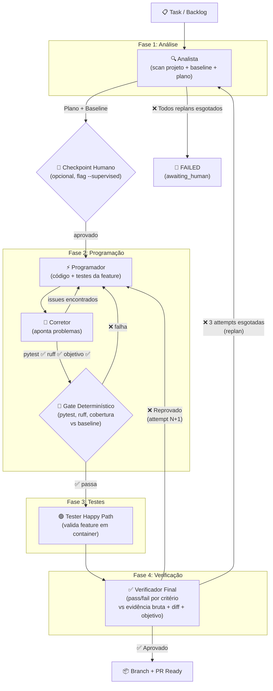

# MAT — Arquitetura

> Versão 2.0 — Alinhada com as decisões D01–D32

## 1. O que o MAT é

Um **workflow com loops de agente** dentro de alguns nós. Não é um sistema de agentes livres.

Padrões da taxonomia Anthropic usados:
- **Encadeamento** (chaining): Analista → Programador → Tester → Verificador
- **Paralelização**: Testers #1–3 rodam em paralelo (quando todos habilitados)
- **Evaluator-optimizer**: Verificador → Programador (feedback loop com attempts imutáveis)

## 2. Diagrama do Pipeline



## 3. Stack

| Camada | Tecnologia |
|---|---|
| **Tudo** | Python 3.12+ |
| **Banco** | SQLite WAL via `aiosqlite` (reader + writer separados, lock de escrita) |
| **LLM** | SDK `anthropic` direto, modelos de `agents.yaml` |
| **Sandbox** | Docker (`docker exec`, `--network none`, rootfs RO) |
| **Tools** | Schemas Anthropic: `text_editor_20250728`, `bash_20250124` |
| **TUI** | Textual |
| **Git** | Worktrees para isolamento por run |

## 4. Estrutura do Projeto

Veja árvore em `src/mat/` no repositório. Referência:

```
src/mat/
├── cli.py              # entry point (mat run, mat resume, mat report)
├── settings.py         # carrega mat.yaml + agents.yaml (Pydantic)
├── db/                 # SQLite: schema, connection, repos/
├── engine/             # pipeline, state_machine, orchestrator, budget
├── agents/             # base, loop, llm, analyst, programmer, reviewer, testers/, verifier
├── tools/              # handlers para text_editor e bash (validação de path)
├── sandbox/            # docker_runner, worktree
├── gate/               # deterministic (pytest/ruff/coverage), baseline
├── models/             # Pydantic: Plan, Implementation, TestResult, Verdict
├── evidence.py         # hash content-addressed + ledger
├── decision.py         # choose/score com structured output (só Analista)
├── memory/             # embedder, pr_store, indexer (Fase 2)
└── tui/                # Textual app, screens, widgets
```

## 5. Modelo de Dados

O schema completo está em [`src/mat/db/schema.py`](../src/mat/db/schema.py).

Tabelas principais:
- **runs**: objetivo, status (inclui `awaiting_human`), fase atual, contadores
- **plans**: plano gerado pelo Analista, vinculado à run
- **baselines**: pytest/ruff/coverage medidos ANTES de qualquer mudança
- **attempts**: tentativa imutável (plan_index × attempt_index), tokens, timeout
- **tasks**: unidade de trabalho por agente
- **task_deps**: dependências normalizadas (sem JSON)
- **dispatches**: execução de uma task numa attempt
- **evidence**: ledger content-addressed com PK composta (evidence_id, run_id)
- **checkpoints**: snapshot de estado para pausa/retomada

## 6. Controle de Tentativas (sem ciclos no DAG)

Não existem arestas de volta. Cada reprovação cria uma **Attempt nova e imutável**.

```
Plano 1 (Analista)
  ├── Attempt 1 → Programador → Corretor → Gate → Tester → Verificador → ❌
  ├── Attempt 2 → Programador → ... → ❌
  └── Attempt 3 → ... → ❌ → ESCALA para novo plano

Plano 2 (Analista gera novo plano)
  ├── Attempt 4 → ... → ✅ APROVADO
  └── (ou Attempt 5, 6 → ❌ → ESCALA para plano 3 ou FAIL)

Máximo: 3 planos × 3 attempts = 9 attempts totais
```

## 7. Segurança

Veja [`docs/threat-model.md`](./threat-model.md).

Resumo: repo-alvo e saída de tools são **não confiáveis**. Edição no host com validação de path; execução no container com rede bloqueada. Saída só por PR revisado.

## 8. Padrões Arquiteturais

| Padrão | Origem | Uso no MAT |
|---|---|---|
| **Blackboard** | Orca | SQLite WAL como state store central |
| **Attempts Imutáveis** | — | Cada tentativa é um registro novo, sem ciclos |
| **Content-Addressed Evidence** | REA | Hash SHA-256 por observação, PK composta com run_id |
| **Gate Determinístico** | — | pytest/ruff/cobertura antes do LLM |
| **Evaluator-Optimizer** | Anthropic | Verificador → Programador com feedback estruturado |
| **Escalação Reversa** | — | Programador → Analista quando attempts esgotam |
| **Checkpoint/Resume** | n8n/Orca | Serializa estado para DB, suspende, retoma |
| **Worktree Isolation** | Orca | Git worktree por run |
| **Host Edit / Container Exec** | SWE-agent | Edição segura no host, execução isolada no container |
| **Handoff por Pydantic** | MAST | Contratos tipados entre agentes, não texto livre |
| **Majority Voting** | Xiong et al. | Verificador roda N vezes onde suspeitar (Fase 2) |
